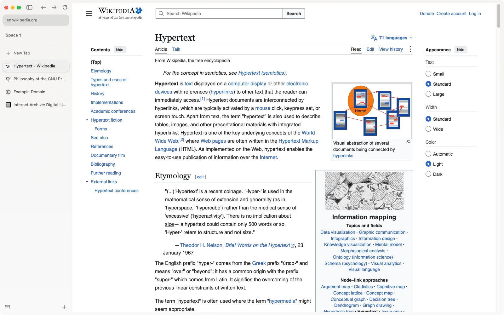

# ilo

a good tool.



ilo is an open-source web browser. Your tabs live in a sidebar, in Spaces: each Space keeps its own pinned tabs and today's tabs, and today's tabs you leave alone move to the archive. A command bar opens pages, tabs and commands, and two pages can share a window side by side. Underneath is Chromium, by way of ungoogled-chromium, so websites work as they should, and extensions install from the Chrome Web Store.

ilo is also the browser AI agents work in. Claude Code, Codex or any MCP client can work in your logged-in sessions, in a Space of its own, with only the permissions you give it, and it never reads your passwords or cookies. Agents are off until you turn them on.

## "What are you selling?"

Nothing. ilo is free, and licensed under the GPL. The browser has no paid features, no license checks and no ads, and it doesn't sell your data.

Services that hold your data, such as sync, can be self-hosted. The hosted ones we run may cost money one day; the browser won't.

Official builds differ from a fork only in their branding, signing keys and default service URLs. If ilo ever goes the wrong way, you have everything you need to build your own.

## Install

Every release is on [GitHub Releases](https://github.com/MartinPTielemans/ilo/releases), with its notes. Once installed, ilo keeps itself up to date.

### macOS

macOS 15 (Sequoia) or later, on Apple silicon. Download [ilo-mac-arm64.dmg](https://github.com/MartinPTielemans/ilo/releases/latest/download/ilo-mac-arm64.dmg), open it and drag ilo into Applications.

### Windows

Windows 10 (1809) or later, on x64. Download [ilo-windows-x64-setup.exe](https://github.com/MartinPTielemans/ilo/releases/latest/download/ilo-windows-x64-setup.exe) and run it. It isn't signed yet, so Windows may warn you before it runs. Once installed, ilo updates itself.

ilo will also be on winget (`winget install ilo.ilo`) and in the Microsoft Store, once each has accepted it.

### Linux

x86-64, as a Flatpak:

```bash
flatpak install --user https://github.com/MartinPTielemans/ilo/releases/latest/download/ilo.flatpakref
```

Then start ilo from your apps. It updates with your other Flatpaks.

## Some notes

ilo is in beta. Expect bugs, and please report them in [Issues](https://github.com/MartinPTielemans/ilo/issues/new/choose); in ilo, Help › Report a Problem… fills in the details for you. [#454](https://github.com/MartinPTielemans/ilo/issues/454) tracks what's left for 0.1.0.

Contributions are welcome. [CONTRIBUTING.md](CONTRIBUTING.md) says what's likely to land and how to send it.

## Status

| Phase | What | State |
|---|---|---|
| 0 | UX spec, measured | in progress: Peek, extensions, passwords, themes and drags left |
| 1 | Architecture spike: GPUI + Chromium in one process | done |
| 2 | Engine: ungoogled-chromium + patch series, prebuilt | done |
| 3 | Daily-driver MVP on Mac | in progress: updates, password fill and sign-in popups done; import left |
| 4 | Polish and parity | — |
| 5 | Windows, then Linux | in progress: 0.1.0 ships on both |

[docs/roadmap.md](docs/roadmap.md) has each phase's exit check.

## Documentation

- [Decisions](docs/decisions.md): why the stack is what it is, and what would change it.
- [Roadmap](docs/roadmap.md): each phase, where it stands and the check that ends it.
- [UX principles](docs/ux-principles.md): the principles behind ilo's design.
- [UX spec](docs/ux-spec.md): every surface, how it looks, moves and behaves, measured.
- [UX parity](docs/ux-parity.md): the checklist built from the spec.

## Build from source

The app builds on a prebuilt engine that `app/setup.sh` downloads, so you don't need to build Chromium:

```bash
cd app
./setup.sh
./build.sh
```

On the Mac that makes `app/build/Browser.app`, and on Linux `app/build/Browser`, which `tools/flatpak.sh` packs as a Flatpak. On Windows, run `app/setup.sh` in Git Bash, then `cargo build --release --manifest-path app/windows/Cargo.toml` builds `Browser.dll`, which the engine's `chrome.exe` loads.

[AGENTS.md › Dev](AGENTS.md#dev) has the UI's preview, the checks and the rest, and [engine/README.md](engine/README.md) covers building the engine and its patches.

## Releases

`.github/workflows/release.yml` makes a release from an annotated tag, `git tag -a v<version>` on a commit whose `app/Cargo.toml` has that version, with the release notes as the tag's message. Each OS builds on its prebuilt engine for that commit, and the run stops if there isn't one. The Windows engine builds nightly, so before pushing the tag, run Engine on Windows (cross-compiled) on its commit, `gh workflow run engine-windows-cross.yml --ref main` with main at that commit, and wait for its release `engine-windows-<commit>`. It makes a draft release whose files keep their names, so `releases/latest/download/<name>` always links the newest: `ilo-mac-arm64.dmg`, `ilo-windows-x64.msix`, `ilo-windows-x64-setup.exe`, `ilo-linux-x86_64.flatpak`, `ilo.flatpakref`, `SHA256SUMS` and `appcast.xml`. Once the draft is published, the `publish` job puts its `appcast.xml` in release `updates`, the feed the Mac and Windows builds read (`app/branding/update-feed`). The run's `winget` artifact holds winget's manifests for the release's installer, for a pull request to [microsoft/winget-pkgs](https://github.com/microsoft/winget-pkgs).

The draft also holds `ilo-demo.tar.gz`, the site's live demo built from the same commit (`.github/workflows/demo.yml`), when the commit has one. Once the draft is published, [ilo-site](https://github.com/MartinPTielemans/ilo-site)'s release workflow puts that demo on [ilobrowser.com](https://ilobrowser.com), links its source to the tag and deploys the site, whose download buttons link the newest release. It checks every half hour, or at once with the secret `SITE_DISPATCH_TOKEN`, a fine-grained token with Contents read and write on `MartinPTielemans/ilo-site` alone. Every other release here, the appcast's `updates`, is made with `--latest=false`, or the site's buttons would link it. The prebuilt engines aren't released here, so this repository's Releases hold only ilo's: they're in [ilo-engine](https://github.com/MartinPTielemans/ilo-engine), the repository `engine/prebuilt.ini` names, as `engine-mac-`, `engine-linux-` and `engine-windows-<commit>`, also with `--latest=false`. The engine workflows publish there with the secret `ENGINE_RELEASE_TOKEN`, a fine-grained token with Contents read and write on `MartinPTielemans/ilo-engine` alone.

The Mac's DMG is built only with these repository secrets:

| Secret | What |
|---|---|
| `MAC_CERTIFICATE_P12` | The Developer ID Application certificate and its key, as a base64 `.p12` |
| `MAC_CERTIFICATE_PASSWORD` | The `.p12`'s password |
| `MAC_NOTARY_KEY` | An App Store Connect API key for notarization, as a base64 `.p8` |
| `MAC_NOTARY_KEY_ID`, `MAC_NOTARY_ISSUER_ID` | That key's ID and its issuer's |
| `UPDATE_PRIVATE_KEY` | The updates' signing key: the contents of the file `generate_keys --account ilo -x <file>` writes (`tools/appcast.sh`) |

The Mac and Windows builds carry its public half from `app/branding/update-key`, or from an `UPDATE_PUBLIC_KEY` secret, which overrides the file when it's set.

Crash reports' symbols go to the collector `app/branding/crash-reports` names only with the secret `SENTRY_AUTH_TOKEN`, an organization auth token that may upload debug files, and the variables `SENTRY_URL`, `SENTRY_ORG` and `SENTRY_PROJECT`, the collector's address, organization and project: for ilo's, `https://de.sentry.io` (Sentry's EU region), `ilo-rg` and `ilo`. Each OS's job uploads its own (`tools/symbols.sh`), and `app/build.sh prod` uploads the Mac's, the owner's daily copy too, with the same four in its environment. Without the token the packages are still built, and say no symbols were uploaded.

The Windows packages are unsigned: the Store signs the MSIX, and winget takes the installer.

Linux installs from GitHub update from ilo's Flatpak repository, a static OSTree repository in a Cloudflare R2 bucket (`tools/flatpak-repo.sh`). The bundle and `ilo.flatpakref` name it and carry its public key. The run adds the build to the bucket, unseen; publishing the draft makes it live. Publish each draft before building the next, since a build doesn't follow a draft that isn't live yet. The Linux files are built only with these:

| Secret | What |
|---|---|
| `FLATPAK_GPG_KEY` | The repository's signing key, ASCII-armoured, without a passphrase |
| `R2_BUCKET` | The bucket's name |
| `R2_ENDPOINT` | `https://<account-id>.r2.cloudflarestorage.com` |
| `R2_ACCESS_KEY_ID`, `R2_SECRET_ACCESS_KEY` | An R2 API token with Object Read & Write on that bucket alone |

and the repository variable `FLATPAK_REPO_URL`, the bucket's public address, such as `https://flatpak.<domain>/`.

Once, before the first release:

1. Make the key: `gpg --quick-gen-key "ilo Flatpak repository" rsa4096 sign never`, with an empty passphrase. Put `gpg --armor --export-secret-keys <fingerprint>` in `FLATPAK_GPG_KEY` and keep a copy offline forever. Every installed copy checks it, and a new key strands them.
2. In Cloudflare, create the R2 bucket, connect a custom domain to it for public reads, and create the API token.
3. Add the secrets and the variable. The address is permanent too, as installs keep it.

## License

GPL-3.0-or-later. See [LICENSE](LICENSE), and [NOTICE](NOTICE) for the other projects ilo uses and carries. In the app, Settings › About opens both, the Rust libraries built into it and their licenses, and Chromium's credits. The name ilo and its icon are the project's trademarks and are not covered by the license. Forks are welcome under their own name: replace `app/branding/`, which holds the name, the icon and the crash collector's URL, and recompile the icon with `app/icon.sh`. On Windows the engine has the name too, for its folders and the names it registers with Windows (`engine/patches/ours/chromium-windows-product-folder.patch`, `chromium-windows-app-names.patch`), so a fork builds its own Windows engine with its name there.

Contributions use the [Developer Certificate of Origin](CONTRIBUTING.md#sign-off), not a CLA.
